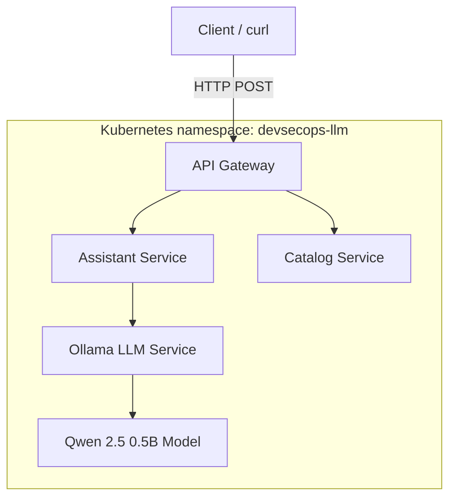

# DevSecOps and CPU-Only LLM Deployment on Kubernetes

CPU-only LLM assessment using Ollama and Qwen 2.5 0.5B on Kubernetes, with an API gateway, assistant and catalog services, Kubernetes security controls, offline deployment artifacts, and security scan evidence.

**Repository:** https://github.com/2plus2world/devsecops-llm-assessment

> Results below describe checks recorded during development, not a fresh run. The Ollama image scan reported vulnerabilities; this project should not be described as vulnerability-free.

## Architecture



The gateway receives client requests and coordinates with the assistant and catalog services. The assistant uses Ollama for model inference. Ollama serves the Qwen 2.5 0.5B model using CPU resources.

## Repository layout

```text
.github/workflows/ci.yml   CI workflow
services/                  API gateway, assistant and catalog code/Dockerfiles
k8s/                       Application, LLM, security, network policy, monitoring and jobs
docs/                      Runbook, threat model, offline deployment and checklist
evidence/                  Captured API, catalog and Kubernetes evidence
reports/                   Trivy report and CycloneDX SBOM
scripts/                   Export, verification, scanning, rollback and teardown scripts
AI_USAGE.md                AI usage disclosure
README.md                  Project documentation
```

## Prerequisites

- Docker, `kubectl`, kind and Git
- PowerShell on Windows when using the provided `.ps1` scripts
- Sufficient disk space for the Ollama image and model artifacts

## Deployment

Run from the repository root in PowerShell. The commands assume the kind cluster and namespace are named `devsecops-llm`. Do not recreate an existing cluster unnecessarily.

### 1. Check the cluster

```powershell
kubectl config current-context
kubectl get nodes
```

If the cluster does not exist, create it:

```powershell
kind create cluster --name devsecops-llm
```

### 2. Build application images

```powershell
docker build -t api-gateway:1.0 .\services\api-gateway
docker build -t assistant-service:1.0 .\services\assistant
docker build -t catalog-service:1.0 .\services\catalog
```

### 3. Load images into kind

```powershell
kind load docker-image api-gateway:1.0 --name devsecops-llm
kind load docker-image assistant-service:1.0 --name devsecops-llm
kind load docker-image catalog-service:1.0 --name devsecops-llm
```

Ensure the Ollama image referenced by `k8s/llm.yaml` is also available to the cluster. For offline deployment, load the archived images as described below.

### 4. Apply manifests

Review the manifests before applying them:

```powershell
kubectl apply -f .\k8s\app.yaml
kubectl apply -f .\k8s\llm.yaml
kubectl apply -f .\k8s\security.yaml
```

Apply NetworkPolicy only after reviewing it and confirming the cluster CNI supports/enforces it:

```powershell
kubectl apply -f .\k8s\network-policy.yaml
```

A successful dry-run or apply does not prove NetworkPolicy enforcement.

### 5. Check workloads and model

```powershell
kubectl get pods,deployments,services -n devsecops-llm
kubectl exec -n devsecops-llm deployment/llm -- ollama list
```

The tested model was `qwen2.5:0.5b`. If it is absent, follow `docs/OFFLINE-DEPLOYMENT.md` to restore model data or download it in an online environment.

### 6. Port-forward the API gateway

Keep this command running in one PowerShell terminal:

```powershell
kubectl port-forward -n devsecops-llm service/api-gateway 8091:8000
```

If local port 8091 is busy, choose another free local port and update the API URL accordingly.

## API usage

The API was tested at `POST /api/v1/ask` via local port `8091`. In a second PowerShell terminal:

```powershell
$body = @{ question = "What products are available?" } | ConvertTo-Json
Invoke-RestMethod -Method Post `
  -Uri "http://localhost:8091/api/v1/ask" `
  -ContentType "application/json" `
  -Body $body
```

The exact response fields are defined in `services/api-gateway/app.py`. A successful response verifies the tested request path, but does not alone prove every failure mode or security property.

## Security controls

- Dedicated `devsecops-llm` namespace.
- Service accounts configured with `automountServiceAccountToken: false` in `k8s/security.yaml`.
- `allowPrivilegeEscalation: false` and dropping Linux capabilities (`ALL`) where configured.
- Read-only root filesystem for gateway, assistant and catalog containers where configured.
- LLM process configured as UID 1000 and seccomp `RuntimeDefault`.
- CPU and memory requests/limits defined in Kubernetes workload manifests.
- Namespace labelled with the Pod Security `restricted` standard during development.
- Default-deny ingress and selected allow rules in `k8s/network-policy.yaml`; actual enforcement depends on the CNI.
- Trivy scan report and CycloneDX SBOM saved under `reports/`.

These controls reduce risk but do not replace runtime validation, secrets scanning, image review, or validation of NetworkPolicy enforcement.

## Testing and evidence

The following results were recorded during development:

| Test | Recorded result | Evidence / notes |
|---|---|---|
| Ollama inference | Passed | `qwen2.5:0.5b` returned `LLM_OK` for a simple prompt |
| Model presence | Passed | `ollama list` showed `qwen2.5:0.5b` in the LLM pod |
| API request | Passed | POST to `/api/v1/ask`; see `evidence/api-success.json` |
| Catalog output | Captured | `evidence/catalog-items.json` |
| Kubernetes status | Captured | `evidence/kubernetes-status.txt` |
| Manifest validation | Passed during development | Client/server dry-run checks were performed |
| Ollama image vulnerability scan | Findings reported | `reports/ollama-trivy-report.json` |
| Ollama image SBOM | Generated | `reports/ollama_ollama_latest-sbom.json` |

### Recorded Trivy findings

The recorded scan of `ollama/ollama:latest` reported 30 Ubuntu OS vulnerabilities: **7 Low and 23 Medium**, plus one Ollama-binary finding with severity `UNKNOWN`. No High or Critical Ubuntu OS findings were reported in that scan. This is a scan of the Ollama image only and reflects the scan time. It does not establish that the application images are free of vulnerabilities. Scan all images again before submission and review/remediate findings by risk.

## Offline deployment

Large image/model archives were created locally in `offline-bundle/`; these archives do not need to be committed to GitHub.

Load the image archives on the offline machine:

```powershell
docker load -i .\offline-bundle\ollama-image.tar
docker load -i .\offline-bundle\application-images.tar
```

Then load the images into kind if required, restore the model archive following `docs/OFFLINE-DEPLOYMENT.md`, deploy the manifests, and test the API. The model directory observed in the tested pod was `/home/ubuntu/.ollama/models`; verify it against `k8s/llm.yaml` before restoring. Claim an offline deployment is verified only if restore and API testing succeed with network access disabled or blocked.

## Known limitations

- **Model persistence:** The current LLM manifest uses `emptyDir`; its data is lost when the pod is removed/recreated. Use a PersistentVolumeClaim or a repeatable model-restore/init procedure for durable deployments.
- **CPU inference:** Latency and throughput depend on CPU resources and request load.
- **NetworkPolicy:** Enforcement depends on the CNI; a manifest dry-run is not proof of enforcement.
- **Vulnerabilities:** The recorded Ollama scan includes Low/Medium findings and an `UNKNOWN` finding. Do not describe the image as vulnerability-free.
- **Image scan coverage:** The referenced Trivy report is for Ollama; scan gateway, assistant and catalog images separately.
- **Mutable image tag:** `ollama/ollama:latest` can change. Pin a reviewed tag or digest for reproducible deployments.
- **Local API URL:** `localhost:8091` works only on the machine running the port-forward.
- **Evidence freshness:** Evidence files reflect a particular run; regenerate after relevant changes.

## Troubleshooting

```powershell
kubectl get pods -n devsecops-llm
kubectl describe pod -n devsecops-llm <pod-name>
kubectl logs -n devsecops-llm <pod-name>
kubectl get svc -n devsecops-llm
```

For model issues:

```powershell
kubectl exec -n devsecops-llm deployment/llm -- ollama list
```

For API issues, confirm the port-forward is running and inspect gateway logs:

```powershell
kubectl logs -n devsecops-llm deployment/api-gateway
```

Use actual resource names from the manifests if they differ.

## Teardown

Only when you are sure the assessment resources are no longer needed:

```powershell
kubectl delete namespace devsecops-llm
```

This deletes namespaced resources, not the kind cluster or local Docker images.

## Further documentation

- [AI usage disclosure](AI_USAGE.md)
- [Runbook](docs/RUNBOOK.md)
- [Threat model](docs/THREAT_MODEL.md)
- [Offline deployment](docs/OFFLINE-DEPLOYMENT.md)
- [Submission checklist](docs/SUBMISSION-CHECKLIST.md)
- [Trivy report](reports/ollama-trivy-report.json)
- [CycloneDX SBOM](reports/ollama_ollama_latest-sbom.json)
